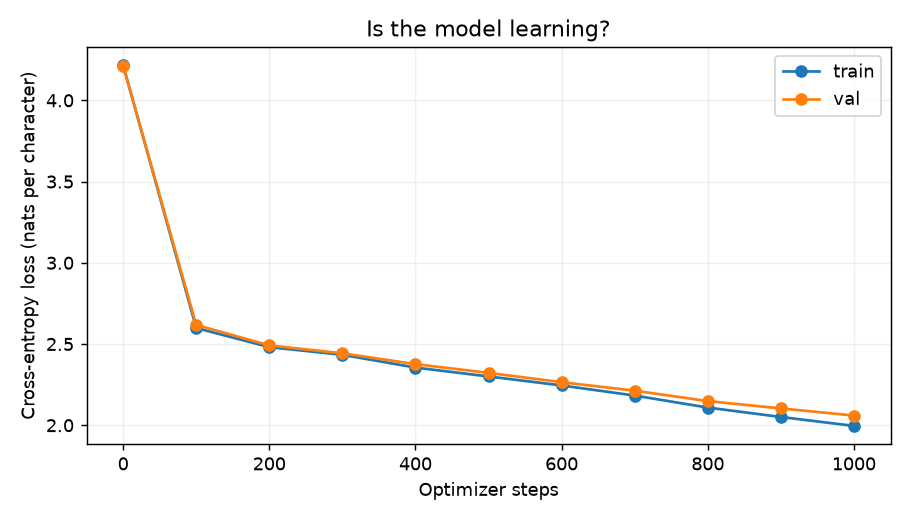

# Tiny GPT From Scratch

A small, character-level GPT built in PyTorch and trained from random weights on Shakespeare's plays. The project implements causal self-attention, transformer blocks, next-character prediction, and text generation in readable Python.

The goal is to understand how a GPT works by building and training one. The included notebook walks through each component and contains outputs from a complete training run.

## Features

- Character tokenizer with a 65-character vocabulary on the included dataset.
- Learned token and position embeddings.
- Multi-head causal self-attention implemented with tensor operations.
- Transformer blocks with layer normalization, residual connections, and feed-forward networks.
- Training with AdamW, cross-entropy loss, dropout, and gradient clipping.
- Held-out validation loss and before/after generation samples.
- Temperature and top-k sampling.
- Checkpoint saving and loading for inference.
- Automatic CUDA selection, with a CPU fallback.
- A self-contained notebook for Google Colab or local Jupyter.

No pretrained weights or high-level transformer implementations are used. PyTorch supplies tensor operations, neural-network primitives, automatic differentiation, and optimization.

## Quick start

### Google Colab

1. Download [Tiny_GPT_From_Scratch.ipynb](Tiny_GPT_From_Scratch.ipynb).
2. Upload it to [Google Colab](https://colab.research.google.com/).
3. Select **Runtime → Change runtime type → GPU**.
4. Run the cells in order.

The notebook installs missing dependencies and downloads the dataset automatically. It does not require the Python script or other project files.

### Local training

Download or clone this repository and open a terminal in its root directory. Python 3.12 was used for the verified run.

Create and activate a virtual environment:

```bash
python -m venv .venv

# Linux / macOS
source .venv/bin/activate

# Windows PowerShell
# .venv\Scripts\Activate.ps1
```

Install PyTorch using the command for your platform from the [official installation selector](https://pytorch.org/get-started/locally/). To run the notebook locally, also install Jupyter and Matplotlib:

```bash
python -m pip install jupyter matplotlib
```

Train the default model:

```bash
python tiny_gpt.py --steps 1000 --out runs/first
```

The script selects CUDA when available and downloads the dataset to `data/input.txt` if the file is missing.

For a smaller CPU experiment:

```bash
python tiny_gpt.py --device cpu --width 64 --layers 2 --context 64 --batch-size 16 --steps 300 --out runs/small
```

For all command-line options:

```bash
python tiny_gpt.py --help
```

## How it works

The model learns to predict the next character at every position. For example:

```text
Input:   H E L L
Target:  E L L O
```

Each character becomes an integer ID, then a learned vector. Position embeddings encode its location in the sequence. Transformer blocks process these vectors, and the output head produces logits for the next character.

Attention uses:

```text
softmax(Q @ Kᵀ / sqrt(head_width) + causal_mask) @ V
```

The causal mask prevents each position from seeing future characters. Cross-entropy measures prediction error, and backpropagation updates the weights. During generation, the model repeatedly samples a character and appends it to the input.

## Default architecture

| Setting | Value |
| --- | --- |
| Parameters on tiny Shakespeare | 824,897 |
| Context window | 128 characters |
| Embedding width | 128 |
| Attention heads per block | 4 |
| Transformer blocks | 4 |
| Feed-forward hidden width | 512 |
| Dropout | 0.1 |
| Batch size | 32 |
| Learning rate | 0.0003 |
| Optimizer | AdamW |
| Training steps | 1,000 |
| Random seed | 1337 |

Defaults are defined in `Config` in [tiny_gpt.py](tiny_gpt.py). The notebook automatically uses a smaller configuration when CUDA is unavailable.

## Training results

The included notebook was executed end to end on an **NVIDIA GeForce RTX 3050 Laptop GPU with 4 GB VRAM**, using Python 3.12.14 and PyTorch 2.14.1+cu126.

| Measurement | Result |
| --- | --- |
| Initial validation loss | 4.214 |
| Final validation loss | 2.060 |
| Final training loss | 1.996 |
| Optimizer steps | 1,000 |
| Training loop, including evaluation | 31.2 seconds |

Loss is measured in nats per character. Evaluation averages ten fixed sampled batches per split; these are estimates rather than full-corpus losses. Timing excludes environment setup, dataset download, and sample generation. Runtime varies by hardware and software.



After this short run, the model begins producing word fragments and dialogue formatting, but spelling and coherence remain limited. An unedited sample:

```text
ROMEO:
I, that fat and my my thus mody and on cepreck.

FLORDIIUS:
No, well, will cown sake gon,
```

See [full before/after samples](runs/first/samples.txt) and [training metrics](runs/first/metrics.json).

## Generate from a saved checkpoint

Run this Python code from the repository root after training:

```python
import torch
from tiny_gpt import load_model

device = 'cuda' if torch.cuda.is_available() else 'cpu'
model, chars = load_model('runs/first/model.pt', device)
stoi = {char: i for i, char in enumerate(chars)}

prompt = 'ROMEO:\n'
ids = torch.tensor([[stoi[char] for char in prompt]], device=device)

torch.manual_seed(42)
generated = model.generate(ids, count=300, temperature=0.8, top_k=40)
print(''.join(chars[i] for i in generated[0].tolist()))
```

Lower temperature makes the distribution sharper; higher temperature adds randomness. `top_k` restricts sampling to the highest-scoring candidates. Prompts must use characters in the saved vocabulary.

## Train on your own text

Provide a UTF-8 text file and a new output directory:

```bash
python tiny_gpt.py --data data/my_text.txt --steps 3000 --out runs/custom
```

The file must already exist; a missing data path triggers the Shakespeare download. The script builds a new character vocabulary and trains a fresh model for the provided corpus. Both the training and validation portions must be longer than the context window.

The first 90% of the text is used for training and the final 10% for validation. Windows never cross the split boundary. The vocabulary is constructed from the whole corpus, so the validation alphabet is visible during tokenizer construction, while validation text does not contribute gradients.

## Project structure

```text
.
├── README.md
├── Tiny_GPT_From_Scratch.ipynb  # Guided lesson with executed outputs
├── tiny_gpt.py                 # Model, training loop, and inference helpers
├── loss_curve.png              # Loss curve from the verified run
├── data/
│   └── input.txt               # Downloaded training corpus
└── runs/
    └── first/
        ├── model.pt           # Model weights, configuration, and vocabulary
        ├── metrics.json       # Configuration, timing, and loss history
        └── samples.txt        # Generated text before and after training
```

## Experiments

Change one setting per run and compare validation loss as well as generated text:

- Train longer with `--steps 3000`.
- Reduce or increase `--width`, keeping it divisible by `--heads`.
- Change `--layers` to study model capacity.
- Increase `--context` to give the model more history.
- Compare temperatures and top-k values using the same prompt and seed.
- Train on a different text collection.

If GPU memory runs out, reduce `--batch-size`. Attention memory grows approximately quadratically with context length.

Each training invocation starts from random weights. Checkpoints support inference, but do not store optimizer state for exact training resumption. This small model is intended for learning and experimentation; it is not an instruction-tuned assistant.

## Verification

The notebook ran successfully through data preparation, training, plotting, checkpoint loading, and generation. Additional development checks passed for:

- Causal masking: modifying future tokens leaves earlier predictions unchanged.
- Finite gradients and successful overfitting of a tiny test batch.
- Identical predictions before and after checkpoint reload.
- Generation beyond the context window and restoration of the model's training mode.

The causal masking check is included in the notebook. The other checks were run during development; this repository does not include a standalone test suite.

## References

- [Attention Is All You Need](https://arxiv.org/abs/1706.03762)
- [PyTorch documentation](https://docs.pytorch.org/docs/stable/index.html)
- [Tiny Shakespeare dataset from Karpathy's char-rnn repository](https://github.com/karpathy/char-rnn/tree/master/data/tinyshakespeare)

The training corpus contains Shakespeare's public-domain plays. Dataset provenance is linked above.
